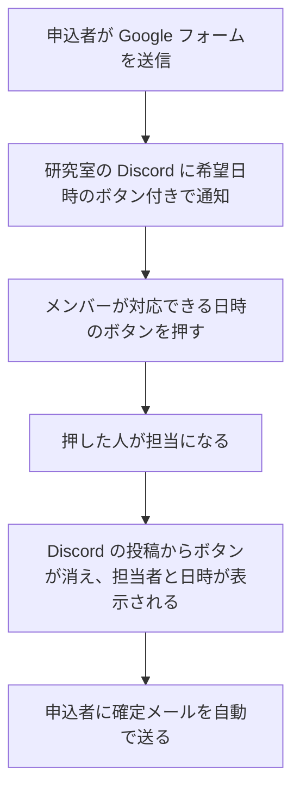
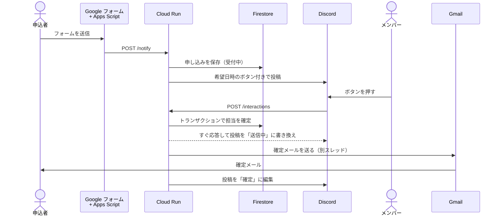
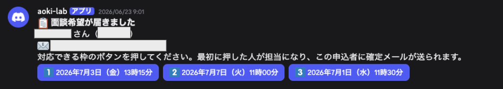
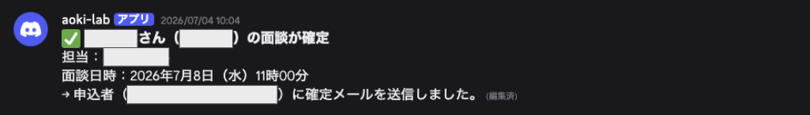

## はじめに

研究室で、配属を考えている学生向けに面談をしています。申し込みは Google フォームで受け付けています。

これまでは申し込みのメールを自分で確認して、チャットでメンバーに対応できるか聞いていました。これが手間だったので、Discord のボタンで調整を済ませる bot を作りました。この記事ではその仕組みと、作るときに詰まったところをまとめます。Discord のボタンを常駐 bot なしで扱いたい人や、フォームの通知を自動化したい人向けです。

## bot の流れ



同じ申し込みを2人が担当しないように、先にボタンを押した人だけが担当になります。担当が決まると投稿からボタンが消えて、誰がいつ対応するかがチャンネルの全員に見えるようになります。

## bot の構成



- **Google Apps Script**：フォームが送信されたら、回答を Cloud Run に POST する
- **Cloud Run functions（Python）**：`/notify` と `/interactions` の2つを受ける
- **Firestore**：申し込みごとに、受付中か確定済みか、担当者、選ばれた枠を持つ
- **Gmail（SMTP）**：研究室の共用アカウントから確定メールを送る

サーバーレスを一度やってみたかったので、サーバーは借りずにこの構成にしました。

## フォームから Cloud Run を呼ぶ

フォームの回答先のスプレッドシートに Apps Script を置いて、「フォーム送信時」のトリガーで動かします。回答の列から値を取り出して POST するだけです。

```javascript:Code.gs
function onFormSubmit(e) {
  var v = e.values;
  var slots = [];
  for (var i = 0; i < COL.slots.length; i++) {
    var dt = v[COL.slots[i][0]];
    var tm = v[COL.slots[i][1]];
    if (dt && tm) slots.push(formatSlot_(dt, tm));
  }
  UrlFetchApp.fetch(ENDPOINT, {
    method: 'post',
    contentType: 'application/json',
    headers: { 'X-Notify-Secret': NOTIFY_SECRET },
    payload: JSON.stringify({
      name: v[COL.name], studentId: v[COL.studentId], email: v[COL.email], slots: slots,
    }),
    muteHttpExceptions: true,
  });
}
```

`/notify` の URL は誰でも呼び出せるので、共有シークレットをヘッダーに入れて、合わないリクエストは 403 で返しています。

フォームの質問の順番を変えると列番号がずれます。列の対応は `COL` にまとめて、変わったらそこだけ直せばいいようにしました。

## 常駐 bot なしでボタンを受け取る

Discord の bot は Gateway に WebSocket でつなぎっぱなしにするイメージがありますが、ボタンなどの操作（Interactions）は HTTP でも受け取れます。Developer Portal の「Interactions Endpoint URL」に URL を登録しておくと、ボタンが押されるたびに Discord がそこへ POST してきます。通知を投稿するほうは、bot のトークンで REST API（`POST /channels/{チャンネルID}/messages`）を呼ぶだけです。受け取りも送信も HTTP で済むので、bot を常駐させる必要がありません。

この方式で押さえておくことは次の3つです。

### 1. 署名の検証

Discord からのリクエストには Ed25519 の署名が付いていて、検証に通らないリクエストは 401 で返します。URL を登録するときにも Discord がわざと不正な署名のリクエストを送ってきて、正しく拒否するかを確かめられます。

```python:main.py
from nacl.exceptions import BadSignatureError
from nacl.signing import VerifyKey

def _verify(request):
    sig = request.headers.get("X-Signature-Ed25519")
    ts = request.headers.get("X-Signature-Timestamp")
    if not sig or not ts:
        return False
    body = request.get_data(as_text=True)
    try:
        VerifyKey(bytes.fromhex(PUBLIC_KEY)).verify(
            f"{ts}{body}".encode(), bytes.fromhex(sig)
        )
        return True
    except (BadSignatureError, ValueError):
        return False
```

### 2. PING への応答

URL の登録時に `type: 1`（PING）が届くので、`{"type": 1}` を返します。

### 3. `custom_id` に申し込みの ID を入れる

ボタンの `custom_id` を `pick:<FirestoreのドキュメントID>:<枠の番号>` にしています。押されたときにどの申し込みのどの枠かがここから分かるので、メッセージと申し込みの対応を別に保存しなくて済みます。

```python:main.py
def _build_components(doc_id, slots):
    buttons = [
        {
            "type": 2,
            "style": 1,
            "label": slot,
            "emoji": {"name": SLOT_EMOJIS[i]},
            "custom_id": f"pick:{doc_id}:{i}",
        }
        for i, slot in enumerate(slots)
    ]
    return [{"type": 1, "components": buttons}]
```

実際に届く通知はこちらです。希望日時ごとにボタンが並びます。



## 早い者勝ちで担当を決める

2人がほぼ同時にボタンを押すと、確定メールが2通送られてしまいます。これを防ぐため、Firestore のトランザクションの中で、受付中のときだけ確定済みに書き換えています。

```python:main.py
@firestore.transactional
def claim(tx):
    snap = ref.get(transaction=tx)
    if not snap.exists:
        return {"result": "missing"}
    d = snap.to_dict()
    if d.get("status") == "claimed":
        return {"result": "taken", "data": d}
    tx.update(ref, {"status": "claimed", "claimedBy": responder, "claimedSlot": slot_i})
    return {"result": "claimed", "data": d}
```

:::message
担当が決まった時点で投稿のボタンは消えますが、ほぼ同時に押された場合はあとの人の操作も届きます。そのときは `flags: 64` を付けて、押した本人にだけ「すでに○○さんが対応予定です」と見せます。チャンネルにはメッセージが増えません。

```python:main.py
def _ephemeral(text):
    return _json({"type": 4, "data": {"content": text, "flags": 64}})
```
:::

## Discord の3秒制限に引っかかる

Discord は Interaction を受け取ってから3秒以内に応答しないと、「インタラクションに失敗しました」と表示します。

最初は、ボタンが押されたらその場でメールを送って、送り終わってから応答していました。これだと時間内に応答が返らず、申込者にメールは届くのに Discord の投稿は書き換わらない、という状態になりました。Gmail の SMTP は送るだけで数秒かかることもあり、コールドスタートの遅れも重なっていたのかもしれません。

そこで、メールは後回しにして次の順で処理するようにしました。

1. `type: 7`（UPDATE_MESSAGE）ですぐ応答し、投稿を「⏳ 確定メールを送信しています…」に書き換えてボタンを消す
2. メールは別スレッドで送る
3. 送り終わったら、Interaction のトークンで元の投稿を「✅ 確定」に編集する

すぐ応答して、メールは別スレッドに回す部分です。

```python:main.py
# ...（前略）
threading.Thread(
    target=_finalize,
    args=(ref, d, slot_label, responder, body["application_id"], body["token"]),
    daemon=True,
).start()

return _json({"type": 7, "data": {"content": content, "components": []}})
```

送り終わったら、元の投稿を編集する部分です。

```python:main.py
def _edit_original(app_id, token, content, components):
    requests.patch(
        f"{DISCORD_API}/webhooks/{app_id}/{token}/messages/@original",
        json={"content": content, "components": components},
        timeout=10,
    )
```

最後は、投稿がこの表示に変わります。



メールの送信に失敗したら、Firestore を受付中に戻してボタンを出し直します。誰かがもう一度押せばやり直せます。

### Cloud Run の CPU 割り当て

Cloud Run は標準だと応答を返したあとの CPU をほとんど割り当てません。応答後に動く別スレッドが最後まで進まないおそれがあるので、CPU を常に割り当てる設定にしています。

```bash:deploy.sh
gcloud run services update "$FUNCTION_NAME" --region="$REGION" --cpu=1 --no-cpu-throttling
```

## Gmail で日付の行が崩れる

確定メールに、たとえば `2026/05/30 11:00` という形式で日時を入れていたら、Gmail で開いたときに日付が自動でリンクになり、その行だけ余白が入って崩れました。

日付を「2026年5月30日（土）11時00分」の形にして、年と月、月と日、時と分の間にゼロ幅スペース（`U+200B`）を挟んだら直りました。見た目は変わりません。

```python:main.py
zwsp = "\u200b"
return (
    f"{dt.year}年{zwsp}{dt.month}月{zwsp}{dt.day}日"
    f"（{_WEEKDAYS_JP[dt.weekday()]}）{dt.hour}時{zwsp}{dt.minute:02d}分"
)
```

## おわりに

bot を入れてからは、メールを確認してチャットで聞いて回る必要がなくなり、ボタンを押すだけで面談の日時が決まるようになりました。

動くのはフォームが送信されたときとボタンが押されたときだけで、常駐する bot もサーバーも置かずに済みました。
