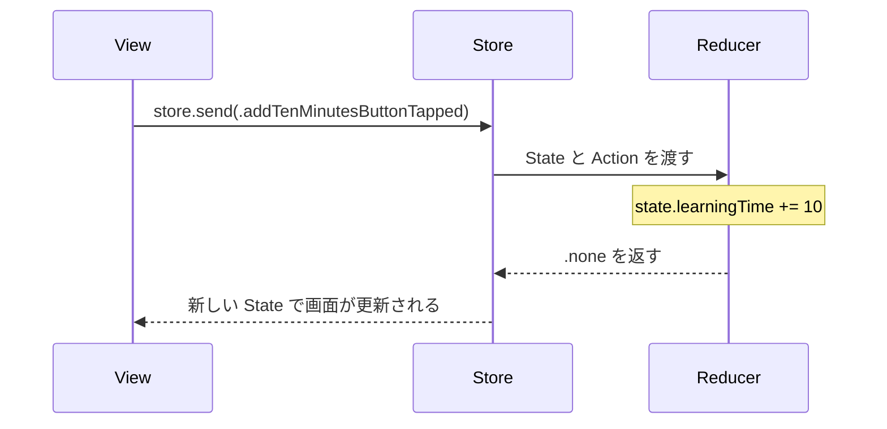

## はじめに

The Composable Architecture（TCA）のチュートリアルを終えたあと、学習時間を記録する練習アプリを作りました。学習内容を入力し、「10分追加」ボタンで学習時間を増やし、保存できるだけの小さなアプリです。

チュートリアルを読んだときは State や Reducer をなんとなく分かった気でいましたが、実際に書くと Store が何をしているのか分からず、手が止まりました。この記事では State や Store など TCA の基本で分からなかったことと、コードを書いて分かったことをまとめます。

TCA を触り始めたばかりの人向けです。

:::message
TCA 1.26.2 で書いています。
:::

## State・Action・Reducer・Store の役割

練習アプリの「10分追加」ボタンを例にします。ボタンを押してから画面の数字が変わるまでは、次の流れです。



| 型 | 役割 | 練習アプリでの例 |
|---|---|---|
| State | 今の状態 | `learningTime`、`learningContent` |
| Action | 起きた出来事 | `addTenMinutesButtonTapped` |
| Reducer | Action を受けて State を変える | `state.learningTime += 10` |
| Store | State を持ち、Action を Reducer に渡す | `StoreOf<LearningFeature>` |

Reducer のコードはこうです。

```swift:LearningFeature.swift
case .addTenMinutesButtonTapped:
    state.learningTime += 10
    return .none
```

View は学習時間を自分で増やしません。「10分追加ボタンが押された」という Action を Store に送るだけです。

```swift:LearningView.swift
Button("10分追加") {
    store.send(.addTenMinutesButtonTapped)
}
```

## Store が分からなかった

いちばん分からなかったのが Store です。State と Reducer は名前から役割を想像できましたが、Store は何のためにあるのかがつかめませんでした。

Store は `App` 構造体の中で作り、View に渡しています。

```swift:tcaApp.swift
LearningView(
    store: Store(initialState: LearningFeature.State()) {
        LearningFeature()
    }
)
```

`initialState` に最初の State を、後ろのクロージャーに Reducer を渡しています。つまり Store は今の State と、State を変える Reducer の両方を持っています。

最初は Action を Reducer に渡すだけの中継役だと思っていました。実際は State そのものを持っていて、保存などの非同期の処理（Effect）を動かすのも Store です。

## State はいつまで残るのか

最初は、State は一時的な値しか持てないものだと思っていました。

実際には、State がいつまで残るかは Store の寿命で決まります。練習アプリでは Store を `App` 構造体の中で作っているので、アプリが動いている間は `learningTime` が残ります。

ただし、State はメモリ上にあるだけなので、アプリを終了すると消えます。

## Action の名前

最初は `resetTime` のように、したい処理を名前にしていました。今は次のようにしています。

```swift:LearningFeature.swift
case resetButtonTapped
case saveButtonTapped
case saveCompleted
```

Action には「したい処理」ではなく、「ボタンが押された」のようなユーザーの操作を名前にするのがよいと、公式チュートリアルに書かれています。例では `incrementCount` ではなく `incrementButtonTapped` と名付けています（[Your first feature](https://swiftpackageindex.com/pointfreeco/swift-composable-architecture/1.26.2/tutorials/composablearchitecture/01-01-yourfirstfeature)）。

`saveButtonTapped` は保存ボタンが押されたこと、`saveCompleted` は保存が終わったことです。保存ボタンが押されたときに何をするかは Reducer に書きます。

## `@Binding` と `@Bindable`

TextField を Store につなぐところで混乱しました。どちらも SwiftUI の機能で、名前は似ていますが役割が違います。

- `@Binding`：親が持っている値を、子の View から読み書きするためのもの
- `@Bindable`：Observable なオブジェクトのプロパティから Binding を作るためのもの

TCA の Store も Observable なオブジェクトです。TextField につなぐには `$store.learningContent` のような Binding が要るので、Store に `@Bindable` を付けます。

```swift:LearningView.swift
@Bindable var store: StoreOf<LearningFeature>
```

State を読んで Action を送るだけなら、`@Bindable` は要りません。練習アプリの詳細画面は `let` で受け取っています。

```swift:LearningDetailView.swift
let store: StoreOf<LearningDetailFeature>
```

最初は TextField の入力を Action として送る形で書きました。

```swift
TextField(
    "入力",
    text: $store.learningContent.sending(\.learningContentChanged)
)
```

`$store.learningContent` で Binding を作り、`.sending(\.learningContentChanged)` で「値が変わったらこの Action を送る」と指定しています。「Swift」と入力すると、`.learningContentChanged("Swift")` が Reducer に届きます。

この書き方だと、入力欄が増えるたびに Action を足す必要があります。そこで今は `BindableAction` と `BindingReducer()` を使っています。

```swift:LearningFeature.swift
enum Action: Equatable, BindableAction {
    case binding(BindingAction<State>)
    // ...
}

var body: some ReducerOf<Self> {
    BindingReducer()
    Reduce { state, action in
        // ...
    }
}
```

```swift:LearningView.swift
TextField("入力", text: $store.learningContent)
TextField("目標", text: $store.learningGoal)
```

こうすると、入力欄ごとに Action を書かなくても State が更新されます。

## Feature は1画面に1つなのか

練習アプリでは State・Action・Reducer をまとめた型に `LearningFeature` のように Feature と付けています。最初は「1画面に1つの Feature」だと思っていましたが、そう決まっているわけではありません。

学習記録の画面の `LearningFeature` はアラートと詳細画面の `LearningDetailFeature` を子として持っています。

```text
LearningFeature（親）
├── 学習内容と学習時間
├── リセット確認のアラート
└── LearningDetailFeature（子。詳細画面）
```

画面の単位と Feature の単位が同じになるとは限りません。どの State をどこが持つかを考えて分けます。

## おわりに

この記事では State・Action・Reducer・Store だけを扱いました。Effect と Dependency、アラートや画面遷移、子の画面から親に知らせる方法は、別の記事で書きます。
